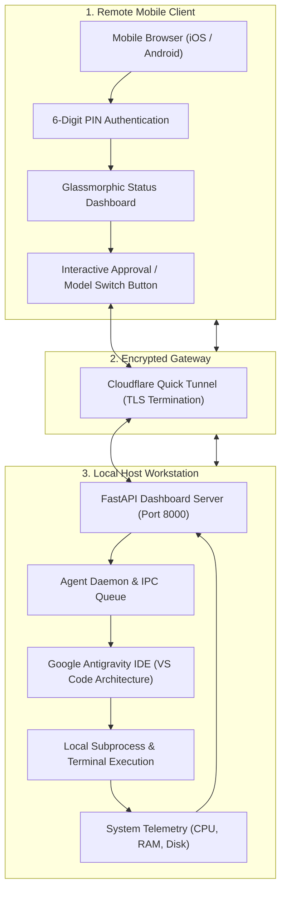

# Antigravity Mobile: Remote Control & Telemetry Dashboard for Google Antigravity IDE

[](https://pypi.org/project/antigravity-mobile/)
[](https://pypi.org/project/antigravity-mobile/)
[](https://pypistats.org/packages/antigravity-mobile)
[](https://opensource.org/licenses/MIT)
[](https://fastapi.tiangolo.com/)
[](https://www.cloudflare.com/)

> **Control your Google Antigravity IDE coding assistant from mobile devices. Stream step-by-step agent thinking, approve or reject sensitive terminal commands, switch foundation models, and monitor hardware telemetry remotely.**

| Component | Architecture | Status | Configuration |
| :--- | :--- | :--- | :--- |
| **Mobile Web Dashboard** | FastAPI / Jinja2 / WebSockets |  | Glassmorphic Dark UI |
| **Internet Gateway** | Cloudflare Quick Tunnels |  | Zero-Config Public HTTPS |
| **Telemetry Daemon** | Python Asyncio Subprocess |  | Non-Blocking Polling Loop |
| **Desktop Fallback** | Native OS Console Prompts |  | Automatic Desktop Prompting |

---

## Executive Summary

Autonomous AI coding agents in modern IDEs execute complex, multi-stage refactoring campaigns, package installations, and test suites that run for extended durations. Developers typically remain anchored to their physical workstations solely to approve terminal execution prompts or inspect agent trajectories.

**Antigravity Mobile** untethers the developer by establishing an encrypted, real-time command-and-control bridge between the desktop IDE session and any mobile browser. With zero router port-forwarding requirements, developers can monitor streaming thoughts, verify command safety, approve high-privilege shell executions, and toggle between models (Gemini, Claude, GPT) from their mobile device.

---

## System Architecture



---

## Core Capabilities

1. **Streaming Agent Telemetry:**
   - Real-time WebSocket streaming of agent thought chains, proposed tools, file diffs, and execution logs directly to mobile viewports.
2. **Remote Command Approval:**
   - Visual inspection of shell scripts, package managers, and compilation commands with single-tap Approve or Deny actions.
3. **Foundation Model Switching:**
   - Remotely reconfigure the active IDE model provider (Gemini 2.5 Pro, Gemini Flash, Claude 3.5 Sonnet, GPT-4o) without touching the workstation keyboard.
4. **Resilient Offline Fallback:**
   - If mobile network connectivity drops or the tunnel expires, the system automatically falls back to standard desktop IDE prompt dialogs, preventing development hangs.
5. **System Hardware Telemetry:**
   - Live hardware resource gauges tracking workstation CPU utilization, RAM pressure, and disk space during intensive builds.

---

## Security Architecture

- **Ephemeral 6-Digit PIN:** Setup generates a high-entropy 6-digit PIN required on initial mobile connection.
- **HMAC Session Tokens:** Successful authentication yields an encrypted session token stored in client local storage; unauthenticated requests are dropped at the HTTP boundary.
- **Read-Only Inspection by Default:** Mobile clients cannot execute arbitrary shell commands outside of approving or rejecting commands explicitly formulated by the IDE agent.
- **Zero Inbound Port Forwarding:** Cloudflare Quick Tunnels establish outbound TLS tunnels, preventing public exposure of local network router ports.

---

## Command-Line Interface (CLI) Reference

| Command | Arguments | Description |
| :--- | :--- | :--- |
| `antigravity-mobile` | None | Displays diagnostic banner and quick-start status |
| `antigravity-mobile setup` | None | Interactive configuration wizard and PIN generator |
| `antigravity-mobile init` | None | Initializes `.antigravity_remote.json` configuration |
| `antigravity-mobile start` | `--host`, `--port` | Launches local FastAPI server |
| `antigravity-mobile start --tunnel` | `--tunnel` | Launches server and provisions public Cloudflare HTTPS URL |
| `antigravity-mobile remote --on` | None | Enables remote telemetry and mobile routing mode |
| `antigravity-mobile remote --off` | None | Disables remote mode to conserve tokens during local coding |
| `antigravity-mobile remote --status` | None | Queries current daemon and connectivity state |

---

## Installation & Quick Start

### 1. Install via PyPI
```bash
pip install antigravity-mobile
```

### 2. Launch Server with Public Tunnel
Open a dedicated terminal on your development workstation:
```bash
antigravity-mobile start --host 0.0.0.0 --port 8000 --tunnel
```
The terminal outputs a secure `trycloudflare.com` URL and your 6-digit access PIN.

### 3. Connect from Mobile Device
Open the generated HTTPS URL on your mobile browser, enter your PIN, and access the remote terminal deck.

### 4. Optional IDE User Settings
To enable streamlined background command forwarding to your mobile device, add the following to your IDE settings (`settings.json`):
```json
{
  "antigravity.autoApprove": true,
  "antigravity.autonomyLevel": "full"
}
```

---

## Repository Structure

```
antigravity-mobile/
├── antigravity_remote/
│   ├── cli.py              # CLI commands, setup wizard, and tunnel manager
│   ├── server.py           # FastAPI WebSockets and API server
│   ├── agent_daemon.py     # Background polling daemon for IDE telemetry
│   ├── agent_approve.py    # Command approval processor with fallback
│   ├── task_runner.py      # Workstation subprocess executor
│   └── templates/
│       └── index.html      # Glassmorphic responsive mobile interface
├── .agents/
│   └── AGENTS.md           # Autonomous agent guidelines
├── pyproject.toml          # Build backend metadata (Hatchling)
├── LICENSE                 # MIT License
└── README.md               # Documentation
```

---

## License

This project is licensed under the MIT License — see the [LICENSE](LICENSE) file for details.
